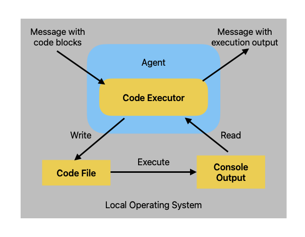

+++
categories = ['Graduate Research Notes']
comments = false
date = '2024-09-04T20:47:24+08:00'
description = 'Brief notes on learning AutoGen and its general framework'
draft = false
math = true
tags = ['Large Language Models', 'AutoGen']
title = 'AutoGen Learning Notes'
+++

## Installing AutoGen
*Using `conda`*
```bash
conda create -n pyautogen python=3.10
conda activate pyautogen
# (optional, run on jupyter) conda install ipykernel -y
# (optional, formatter plugin) conda install black -y
pip install pyautogen
```

## Common Concepts
### `OAI_CONFIG_LIST`
A commonly used configuration file for calling the OpenAI API. It specifies how to connect to OpenAI services, such as the API key and endpoint URL.

### The `top_p` and `temperature` Parameters
`top_p` is sometimes also called `nucleus sampling`. Both parameters control the randomness and diversity of generated text, but they work in different ways.
- **temperature**
    - The `temperature` parameter determines how the model chooses the next word from candidate words. It adjusts the shape of the probability distribution and therefore affects the model's selection preferences. It is usually set in the range $[0,1]$.
    - When `temperature` is close to 0, the model tends to choose the most likely word, making the generated text more predictable but potentially dull.
    - At higher `temperature` values, the model is more inclined to choose randomly. This increases the diversity and novelty of the generated text, but may make sentences less coherent or introduce more errors.
- **top_p (Nucleus Sampling)**
    - `top_p` is a sampling strategy. Rather than changing the probability distribution itself, it first selects a subset of the highest-probability words whose cumulative probability reaches the value `p`.
    - For example, if `top_p` is set to 0.9, the model considers only words whose cumulative probability reaches or exceeds 90%.
    - It then samples from these words according to their relative probabilities. This retains some diversity while avoiding words that are extremely unlikely, which can help improve the quality of generated text.
#### Similarities
- Both are intended to balance randomness and creativity in generated text.
- Users can adjust these two parameters to optimize the generated text for a particular use case.
#### Differences
- `temperature` affects the result by changing the probability distribution, while `top_p` samples only from a subset of high-probability words without changing the distribution.
- `temperature` primarily controls how exploratory the output is—that is, how much it ventures across the probability distribution. `top_p` primarily controls how conservative the output is—that is, how it chooses among already high-probability options.
*It is not recommended to change both at the same time.*

## LLM Configuration
[Official Documentation](https://microsoft.github.io/autogen/docs/topics/llm_configuration)
Using `OAI_CONFIG_LIST` is recommended because it makes it convenient to switch among multiple APIs and models.
```python
config_list = autogen.config_list_from_json(  
	env_or_file="OAI_CONFIG_LIST",
	filter_dict={"model":["gpt-4"]} # Select a model
)

llm_config = {
    "config_list": config_list
	"timeout":120
}
```
- It is best to include the `"timeout"` field in the configuration. Network connectivity issues can otherwise easily cause `connection error` problems.
- If API calls are slow, consider using a model from the `gpt-3.5` series to reduce latency. (However, version 3.5 is rather limited and is suitable only for learning and testing; use it cautiously for other purposes.) Even `gpt-4o-mini` can hallucinate facts. These models seem to focus more on increasing the number of input `token`s, while their intelligence is still insufficient.

## Ways to End a Conversation Between Agents
[Documentation](https://microsoft.github.io/autogen/docs/tutorial/chat-termination/)
### Set a Parameter in the `initiate_chat` Function
e.g.
```python
result = joe.initiate_chat(cathy, message="Cathy, tell me a joke.", max_turns=2)
```
`max_turns` in the code specifies the number of rounds (**for example, `max_turns=2` means each agent speaks twice**) after which the conversation stops.

### Set Parameters When Creating an Agent
The following two parameters can be configured:
1. `max_consecutive_auto_reply`: This parameter can be set in the `ConversableAgent` class. The conversation ends when this agent's **number of responses** to the same sender (note: this counts responses, not received messages) reaches a specified limit. (*Question: How does it terminate? Does it simply stop speaking, or does it say a closing line?*)
2. `is_termination_msg`: Checks whether the received reply contains a termination message, e.g.
```python
joe = ConversableAgent(
    "joe",
    system_message="Your name is Joe and you are a part of a duo of comedians.",
    llm_config={"config_list": [{"model": "gpt-4", "temperature": 0.7, "api_key": os.environ.get("OPENAI_API_KEY")}]},
    human_input_mode="NEVER",  # Never ask for human input.
    is_termination_msg=lambda msg: "good bye" in msg["content"].lower(),
)

result = joe.initiate_chat(cathy, message="Cathy, tell me a joke and then say the words GOOD BYE.")

```

## Human Input
### How Human Input Works
Human input comes before the `agent_auto_reply` logic in the workflow, so it can intercept an incoming message.
(*My understanding:* For example, `Agent A` sends `msg_1` to `Agent B`, but human input can replace `msg_1` with `msg_2` and pass `msg_2` to `Agent B`.)

### Input Modes
Set this through `human_input_mode` in the `Conversable` constructor:
1. `human_input_mode=NEVER`
2. `TERMINATE`: Requests human input when a termination condition is met (for example, when `max_consecutive_auto_reply` or `is_termination_msg` is satisfied). With `max_consecutive_auto_reply`, the counter is reset after human input. Conversely, if the human chooses to skip input, the agent continues with the `auto_reply` mechanism. The human can also choose to end the conversation.
3. `ALWAYS`: The human can skip input and still use `auto_reply`, or intercept `auto_reply` and provide feedback (including ending the conversation). In this mode, `max_consecutive_auto_reply` is disabled.

### Examples
*The following examples provide ample evidence that gpt-3.5 and gpt-4o-mini have poor reasoning abilities: only gpt-4 can correctly complete the number-guessing game.*
#### `NEVER`
```python
agent_with_number = ConversableAgent(
    "agent_with_number",
    system_message="You are playing a game of guess-my-number. You have the "
    "number 53 in your mind, and I will try to guess it. "
    "If I guess too high, say 'too high', if I guess too low, say 'too low'. ",
    llm_config=llm_config,
    is_termination_msg=lambda msg: "53" in msg["content"],  # terminate if the number is guessed by the other agent
    human_input_mode="NEVER",
)

agent_guess_number = ConversableAgent(
    "agent_guess_number",
    system_message="I have a number in my mind, and you will try to guess it. "
    "If I say 'too high', you should guess a lower number. If I say 'too low', "
    "you should guess a higher number. ",
    llm_config=llm_config,
    human_input_mode="NEVER",
)

result = agent_with_number.initiate_chat(
    agent_guess_number,
    message="I have a number between 1 and 100. Guess it!",
)
```
In the `system_message` for `agent_guess_number`, instructing it to use binary search helps it arrive at the answer faster and more accurately. This is an example of RAG.

#### `TERMINATE`
```python
agent_with_number = ConversableAgent(
    "agent_with_number",
    system_message="You are playing a game of guess-my-number. "
    "In the first game, you have the "
    "number 53 in your mind, and I will try to guess it. "
    "If I guess too high, say 'too high', if I guess too low, say 'too low'. ",
    llm_config=llm_config,
    max_consecutive_auto_reply=1,  # maximum number of consecutive auto-replies before asking for human input
    is_termination_msg=lambda msg: "53" in msg["content"],  # terminate if the number is guessed by the other agent
    human_input_mode="TERMINATE",  # ask for human input until the game is terminated
)

agent_guess_number = ConversableAgent(
    "agent_guess_number",
    system_message="I have a number in my mind, and you will try to guess it. "
    "If I say 'too high', you should guess a lower number. If I say 'too low', "
    "you should guess a higher number. ",
    llm_config=llm_config,
    human_input_mode="NEVER",
)

result = agent_with_number.initiate_chat(
    agent_guess_number,
    message="I have a number between 1 and 100. Guess it!",
)
```
The logic in this example is that human input resets `max_consecutive_auto_reply`. `agent_with_number` can reply only once with `too high` or `too low`; if the guess is wrong, a human takes over and replies with `too high` or `too low`.

#### `ALWAYS`
The human plays the guesser.
```python
human_proxy = ConversableAgent(
    "human_proxy",
    llm_config=False,  # no LLM used for human proxy
    human_input_mode="ALWAYS",  # always ask for human input
)

# Start a chat with the agent with number with an initial guess.
result = human_proxy.initiate_chat(
    agent_with_number,  # this is the same agent with the number as before
    message="10",
)
```
## Code Executor
The Code Executor component receives an input message (for example, a message containing a code block), executes it, and outputs a message containing the result. AutoGen provides two types of built-in code executors:
- A command-line code executor, which runs code in command-line environments such as a UNIX shell.
- An executor that runs code in an interactive Jupyter kernel.
Each type of Code Executor can run code locally or in Docker.

### Choosing Between CLI and Jupyter Execution
The choice between a command-line and a Jupyter code executor depends on the nature of the code blocks in the agent conversation. If every code block is a "script" that does not use variables from previous code blocks, a command-line code executor is a good choice. If some code blocks involve expensive computations (for example, training machine learning models or loading large amounts of data) and you want to preserve state in memory to avoid repeating the computation, a Jupyter code executor is a better choice.
### Local Execution Logic and Jupyter Execution in VSCode


#### Running Jupyter in VSCode
```python
from autogen.coding import CodeBlock
from autogen.coding.jupyter import JupyterCodeExecutor, LocalJupyterServer
from autogen import ConversableAgent


with LocalJupyterServer() as server:
    executor = JupyterCodeExecutor(server)

    code_executor_agent = ConversableAgent(
        "code_executor_agent",
        llm_config=False,  # Turn off LLM for this agent.
        code_execution_config={
            "executor": executor
        },  # Use the local command line code executor.
        human_input_mode="NEVER",  # Always take human input for this agent for safety.
    )
    message_with_code_block = """This is a message with code block.
        The code block is below:
        ```python
        print("Jupyter Code Executor test")
        ```
        This is the end of the message.
        """

    # Generate a reply for the given code.
    reply = code_executor_agent.generate_reply(
        messages=[{"role": "user", "content": message_with_code_block}]
    )
    print(reply)
'''
output:
>>>>>>>> EXECUTING CODE BLOCK (inferred language is python)... exitcode: 0 (execution succeeded) Code output: Jupyter Code Executor test
'''
```
Note:
- Using a Code Executor in Jupyter requires one extra step compared with running a `.py` file through the CLI: connecting to a Jupyter kernel, which is the `with LocalJupyterServer() as server` step. After connecting to the kernel, create a `JupyterCodeExecutor` with this connection.
- When using Jupyter execution, first install the dependency with `pip install 'pyautogen[jupyter-executor]'`.
- Azure for Students on the Azure OpenAI API cannot run the code in [Use Code Executor in Coversation](https://microsoft.github.io/autogen/docs/tutorial/code-executors#use-code-execution-in-conversation), because the token limit is exceeded (1k tokens per minutes). Although shortening `code_writer_system_message` as much as possible may reduce the token count enough to run the example code, an insufficient prompt can make the results inaccurate.

## Tool Use
The code written by an agent is not very reliable, so tools are needed. In AutoGen, tools are predefined functions that agents can use. With tools, agents can perform tasks such as searching the web, calculating, reading files, or calling remote APIs.

### Creating a Tool
Tools can be created just like ordinary Python functions:
```python
from typing import Annotated, Literal

Operator = Literal["+", "-", "*", "/"]


def calculator(a: int, b: int, operator: Annotated[Operator, "operator"]) -> int:
    if operator == "+":
        return a + b
    elif operator == "-":
        return a - b
    elif operator == "*":
        return a * b
    elif operator == "/":
        return int(a / b)
    else:
        raise ValueError("Invalid operator")
```
> Tips: It is best to use type hints for function parameters and return values. These also serve as a prompt for the agent.

### Registering a Tool
After creating a tool, register it with an agent so it can be called in a conversation.
```python
import os

from autogen import ConversableAgent

# Let's first define the assistant agent that suggests tool calls.
assistant = ConversableAgent(
    name="Assistant",
    system_message="You are a helpful AI assistant. "
    "You can help with simple calculations. "
    "Return 'TERMINATE' when the task is done.",
    llm_config={"config_list": [{"model": "gpt-4", "api_key": os.environ["OPENAI_API_KEY"]}]},
)

# The user proxy agent is used for interacting with the assistant agent
# and executes tool calls.
user_proxy = ConversableAgent(
    name="User",
    llm_config=False,
    is_termination_msg=lambda msg: msg.get("content") is not None and "TERMINATE" in msg["content"],
    human_input_mode="NEVER",
)

# Register the tool signature with the assistant agent.
# (calculator) is used here as a decorator.
assistant.register_for_llm(name="calculator", description="A simple calculator")(calculator)

# Register the tool function with the user proxy agent.
user_proxy.register_for_execution(name="calculator")(calculator)
```
> Tips: Add appropriate comments to help the agent's LLM understand what the tool does.

## Conversation Patterns
AutoGen provides components for conversations among multiple agents.

### Overview
1. two-agent chat
2. sequential chat: A series of conversations between two agents, where the summary of the previous conversation can be brought into the context of the next one.
3. Group Chat: A conversation involving multiple agents. In this case, an important question is: which agent should speak next? To handle different scenarios, AutoGen provides several ways to organize agent conversations:
	- Choose the next agent in several ways: `round_robin`, `random`, `manual` (human selection), or automatic selection (the default, using an LLM to decide).
	- Provide constraints to limit which agent speaks next.
	- Pass in a function to customize the next agent. This feature can be used to build a **StateFlow** that defines a workflow.
4. Nested Chat: Package a workflow into an agent and reuse that agent in other workflows.
