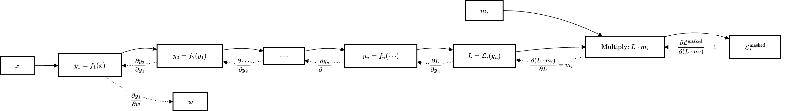

+++
categories = ['Deep Learning']
date = '2025-07-06T18:50:00+08:00'
draft = false
showToc = true
tags = ['PyTorch', 'Machine Learning', 'Python']
title = 'PyTorch Core Concepts and Pitfalls'
+++

## Quickstart: Creating Models

Use `accelerator` to speed up computation:

```python
import torch
import torch.nn as nn

device = torch.accelerator.current_accelerator().type if torch.accelerator.is_available() else "cpu"
print(f"Using {device} device")

# Define model
class NeuralNetwork(nn.Module):
    def __init__(self):
        super().__init__()
        self.flatten = nn.Flatten()
        self.linear_relu_stack = nn.Sequential(
            nn.Linear(28*28, 512),
            nn.ReLU(),
            nn.Linear(512, 512),
            nn.ReLU(),
            nn.Linear(512, 10)
        )

    def forward(self, x):
        x = self.flatten(x)	# The model's actual input is processed here
        logits = self.linear_relu_stack(x)
        return logits

model = NeuralNetwork().to(device)
print(model)
```

In PyTorch (as in most deep learning frameworks), the `forward` function receives an entire batch of data by default, rather than a single sample.

## Cross Entropy

Consider this example:

```python
import torch
from torch.nn import functional as F

logits = torch.tensor([[2, 0.1, 0.1], [0.1, 1, 0.1]])
labels = torch.tensor([0, 1])
loss = F.cross_entropy(logits, labels)
print(loss.item())

# output: 0.4283800423145294
```

Here, `[2, 0.1, 0.1]` contains the three prediction scores (logits) for the first sample (sample `0`), one score for each of three classes: class 0, class 1, and class 2.
- 2 is the score for class 0.
- 0.1 is the score for class 1.
- 0.1 is the score for class 2.

Similarly, `[0.1, 1, 0.1]` contains the scores for the second sample (sample `1`), one for each class.

PyTorch's `cross_entropy` automatically applies the softmax function to the input logits, computes the probability of each predicted class, and then calculates the cross-entropy loss. We therefore do not need to add a softmax layer manually.

## `Dataset` and `DataLoader`

When loading data like this:

```python
for sample_id, query_embedding, pos_embeddings_list, neg_embeddings_list in tqdm(dataloader):
	pass
```

Remember that `DataLoader` **automatically adds a dimension for each sample's batch**. When writing the `forward` function, **pay attention to the dimensions of the input data**.

Since `DataLoader` combines multiple samples into a batch, the samples in a batch naturally need to have the same `shape`. If they do not, pass a `collate_fn` function to control how samples in the batch are processed and padded.

### Example: custom `collate_fn`

```python
def simple_collate_fn(batch):
    queries = torch.stack([item[0] for item in batch])  # [B, 4]
    max_len = max(len(item[1]) for item in batch)

    B = len(batch)
    facts = torch.zeros(B, max_len, 4)
    labels = torch.zeros(B, max_len)
    mask = torch.zeros(B, max_len)
    for i, (q, fact_list, label_list) in enumerate(batch):
        for j in range(len(fact_list)):
            facts[i, j] = fact_list[j]
            labels[i, j] = label_list[j]
            mask[i, j] = 1

    return queries, facts, labels, mask
```

## `Tensor` operations

### `torch.stack`

`torch.stack` concatenates a sequence of tensors along a **new dimension** (unlike `torch.cat()`, which concatenates along an **existing dimension**).

```python
>>> x = torch.randn(2, 3)
>>> x
tensor([[ 0.3367,  0.1288,  0.2345],
        [ 0.2303, -1.1229, -0.1863]])
>>> torch.stack((x, x)) # same as torch.stack((x, x), dim=0)
tensor([[[ 0.3367,  0.1288,  0.2345],
         [ 0.2303, -1.1229, -0.1863]],

        [[ 0.3367,  0.1288,  0.2345],
         [ 0.2303, -1.1229, -0.1863]]])
>>> torch.stack((x, x)).size()
torch.Size([2, 2, 3])
```

### Broadcasting

```python
mat = torch.tensor([[1, 2, 3, 4], [1, 2, 2, 2], [2, 3, 3, 3]])
mat.sum(dim=1, keepdim=True), mat / mat.sum(dim=1, keepdim=True)

# >>> (
# >>>     tensor([[10],
# >>>             [7],
# >>>             [11]]),
# >>>     tensor(
# >>>         [
# >>>             [0.1000, 0.2000, 0.3000, 0.4000],
# >>>             [0.1429, 0.2857, 0.2857, 0.2857],
# >>>             [0.1818, 0.2727, 0.2727, 0.2727],
# >>>         ]
# >>>     ),
# >>> )
```

The process is:
```python
mat_sum = tensor([[10], [7], [11]])

# The broadcast mechanism expands it to:
mat_sum_broadcast = tensor([[10, 10, 10, 10],
                            [7, 7, 7, 7],
                            [11, 11, 11, 11]])
```

Broadcasting means that, subject to certain constraints, a **smaller array is broadcast to a larger array** so that their shapes are compatible.
Two tensors can be broadcast together when:
- Each tensor has at least one dimension.
- When comparing dimensions from the **trailing** dimensions backward, each pair of sizes is either:
  - **equal**;
  - **one of the sizes is 1**; or
  - **one tensor has no dimension at that position**.

## Gradients

During training, `W.grad` refers to $\frac{\partial(Loss)}{\partial(w_i)}$. This is not a mathematical expression, but a concrete value (the **gradient value for the current input**).
A signed expression such as $\frac{dx^2}{dx}=2x$ is called **symbolic differentiation**.

## Masking

### Why can multiplying padding by a mask in the loss function suppress its gradient?

Consider a simple example.

Without a mask:
- $z=w\cdot x$, where $z$ is the prediction.
- $L=\frac 12 (z-\hat z)^2=\frac12(w\cdot x-\hat z)^2$, where $\hat z$ is the target; the intermediate variable in the chain rule is $y_1=w\cdot x$.

With a mask:
- $z=w\cdot x\cdot \text{mask}$
- $L=\frac 12 (z-\hat z)^2=\frac12(w\cdot x\cdot \text{mask}-\hat z)^2$, where $\hat z$ is the target; the intermediate variable in the chain rule is $y_1'=w\cdot x\cdot \text{mask}$.

We update $w$ as follows:

$$w \longleftarrow w - \eta \cdot \frac{\partial L}{\partial w}$$

Expanding this gives:

$$w - \eta \cdot \frac{\partial L}{\partial w} = w - \eta \cdot \frac{\partial L}{\partial y_1}\frac{\partial y_1}{\partial w}$$

With a mask, the expansion is:

$$
w - \eta \cdot \frac{\partial L}{\partial w} = w - \eta \cdot \frac{\partial L}{\partial y_1'}\frac{\partial y_1'}{\partial w} = w - \eta \cdot \frac{\partial L}{\partial y_1'}\frac{\partial (w\cdot x\cdot \text{mask})}{\partial w}
$$

If the corresponding token is padding (`mask=0`), then $\frac{\partial (w\cdot x\cdot 0)}{\partial w} = 0$. This reduces the update to $w = w - \eta \cdot 0$, so the gradient is not updated.

More generally, with a mask, $m_i=0$ makes the entire gradient zero. If we only zero-pad without a mask (that is, set $x=0$), a gradient can still be produced when the loss function is not MSE (for example, when using Cross Entropy), so the padded portion's influence on the gradient is not completely removed.



### Mask drawbacks and risks

Although masking is a **reliable way** to suppress padding, it should not be used blindly in every situation:
1. **Incompatible with some statistics**: During training, some layers (BatchNorm, LayerNorm) compute means and variances over the entire batch. A mask cannot stop them from including padding zeros in those statistics, which can introduce bias. Additional measures such as `nn.SyncBatchNorm`, mask-aware normalization, or putting those layers in eval mode may be needed.
2. **Hardware and library support limits**: Some acceleration libraries (such as native cuDNN convolutions) do not support ragged or masked inputs. Padding must be applied before unified computation, and masking can only be used as post-processing.
3. **Risk of a zero denominator**: If an entire batch is padding ($\sum m_j = 0$), calculating the mean loss causes division by zero. Ensure that each batch has at least one valid sample in the sampler or collate function.
4. **Code complexity and debugging cost**: The same mask must be used consistently in multiple places (`collate_fn`, `loss`, `attention`, and `Pooling`). Missing it in one place can cause subtle bugs.

> **Translation note:** This English version was translated with the assistance of an LLM.
