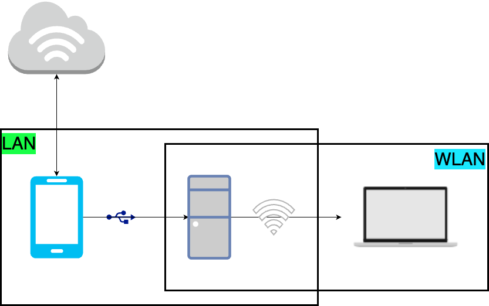

+++
categories = ['Workflow']
comments = false
date = '2024-12-02T15:37:01+08:00'
draft = true
slug = 'SSH连接Windows11'
tags = ['Windows', 'SSH', 'VSCode']
title = 'Connecting to Windows 11 over SSH (Terminal and VS Code Remote-SSH)'
+++

## Environment

I usually work with two devices:
1. A MacBook Pro
2. A Windows 11 desktop

Both devices are in the lab. I use the Mac for coding and portability, but it has only 18 GB of memory and no CUDA acceleration. Many LLMs do not support MPS at the moment, so I use Windows to run model tests.

The two devices are on the same local network. I wanted a more efficient workflow: write code on the Mac and debug it on Windows 11.

There are several options:

1. **Microsoft Remote Desktop**
   This connects to Windows with a **graphical interface**.

   **Drawbacks:**
   - The phone is connected to the Windows desktop over USB to provide internet access, and the desktop shares that connection with the Mac through a mobile hotspot. This places high demands on both the phone's modem and the desktop's wireless card. On macOS, HiDPI also needs to be enabled to make the screen less blurry, which makes the graphical interface quite laggy.
   - Code written on the Mac has to be **copied to** Windows for debugging, making it difficult to keep edits synchronized.
2. **GitHub synchronization**
   This is extremely inconvenient and feels rather clumsy.
3. **VS Code Tunnel**
   It is convenient, but coding in a browser feels uncomfortable. All operations are also relayed through Microsoft servers, which can be slow in China. Since a local network is available, there is no need to route traffic that way.
4. **SSH**
   This is an elegant and efficient approach, and in my view a fairly standard workflow. It is the method described in detail below.

## Initial Connection

*Note: This method applies to Windows accounts signed in with a Microsoft account. Once you know how to do this, connecting with a local Windows account is even simpler.*

System: Windows 11 Pro

I still wanted to play games and use several cloud services, so I did not install Windows Server. When Windows 11 is signed in with an online Microsoft account, there seems to be a limitation: SSH login appears to require the online account and may not work with an RSA key.

1. Press <kbd>WIN</kbd>+<kbd>S</kbd>, search for **Optional features**, install the `OpenSSH Server` component, enable OpenSSH, and configure it to start at boot. Search online for a detailed walkthrough.
2. After that, you should be able to connect to Windows with `ssh username@IP`. To find `username`, open a terminal on Windows and check the default path, for example `C:/User/${username}>`.

The first time you connect from a terminal, you will see the prompt `yes/no/[fingerprint]`. Enter `yes` to log in to Windows with the Microsoft account. In my experience, this was the only way to log in.

If the terminal connection succeeds, the first step is complete!

## Set the Default Shell

When connecting to Windows over SSH, the default shell is `cmd` rather than `powershell`. Linux users may find this unfamiliar (though PowerShell may not feel familiar either), so configure SSH to start PowerShell.

See the [official documentation](https://learn.microsoft.com/zh-cn/windows-server/administration/OpenSSH/openssh-server-configuration#configuring-the-default-shell-for-openssh-in-windows).

## VS Code Remote-SSH (A Gotcha!)

Here is a frustrating gotcha: the terminal connects to Windows successfully, but VS Code's SSH connection fails. The details show that it has connected, but installing the required support components on Windows fails.

The cause was a permissions issue. I had Huorong antivirus installed on Windows, and **it blocked some PowerShell installation tasks**. On the first connection, temporarily disable Huorong or click **Allow** in its notification. That resolves the problem.
